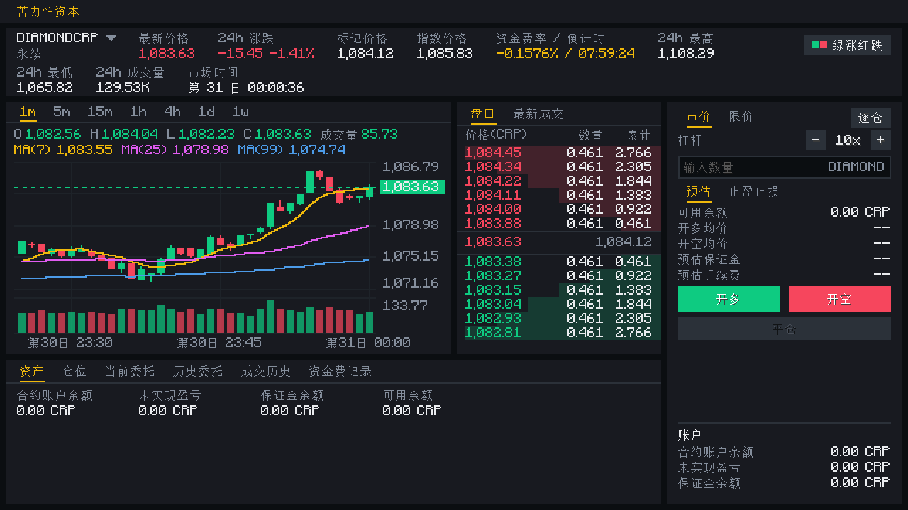
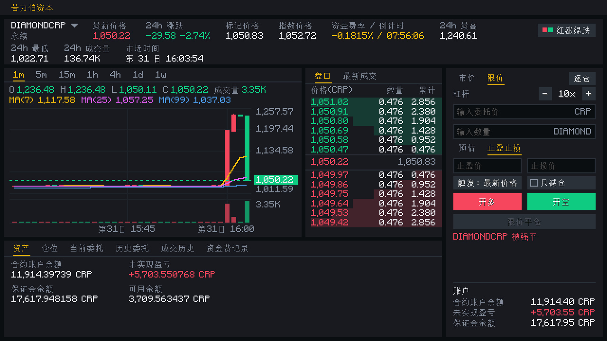

# 苦力怕资本（Creeper Capital）

[English](README.md) | **简体中文**

> 在 Minecraft 里，用一个仿币安的交易所交易以原版资源为标的的永续合约。



苦力怕资本是一个 NeoForge 模组，为 Minecraft 加入一个全服共享的永续合约交易所。合约以原版资源（钻石、火药）为标的，用**苦力怕币（CRP）**计价和结算——CRP 是服务端账本里的余额，不是物品。所有玩家都以系统的**流动性池**为对手方，任何时候都有人接单。

> **状态：内测版（`0.1.0-alpha.1`）。** 首个版本用两个合约验证交易规则和行情手感，难免有粗糙之处；存档格式在内测版本之间可能变化，请备份存档。

## 功能

- **两个永续合约：** `DIAMONDCRP`（最高 125 倍）与 `GUNPOWDERCRP`（最高 50 倍），各有独立的波动率倾向（GARCH、肥尾分布、泊松跳跃、牛/熊/震荡三种市场状态）。合约可在服务端配置文件里定义。
- **仿币安交易界面**（默认按键 **K**）：K 线图（含 MA 与成交量）、盘口、最新成交、下单面板、仓位 / 委托 / 成交 / 资金费表格，并可切换「绿涨红跌 / 红涨绿跌」。
- **委托类型：** 市价、限价、止盈止损、只减仓。
- **保证金：** 逐仓与全仓，杠杆与维持保证金率分档。
- **风控：** 每 8 个市场小时结算资金费、强平、风险保障基金，以及带持仓总量上限的自动减仓（ADL）。
- **沿虚拟流动性曲线产生滑点：** 盘口与成交同源，所见即所得。
- **服务端权威、离线安全：** 你离线时仓位照常结算，上线时收到汇总通知；服务器停止时，市场与所有仓位一起冻结。
- **加速的市场时钟：** 1 真实秒 = 6 市场秒；新建世界时预生成 30 个市场日的历史。
- **语言：** 简体中文与英文。



## 运行环境

| | |
|---|---|
| Minecraft | 26.1.2 |
| 加载器 | NeoForge 26.1.2.124 及以上 |
| Java | 25 |
| 运行端 | 双端（服务端与每个客户端都要安装） |

## 安装

1. 为 Minecraft 26.1.2 安装 NeoForge。
2. 从 [Releases](https://github.com/djp440/CreeperCapital/releases) 页面下载 `creepercapital-<版本>.jar`。
3. 放进客户端（联机时还有服务端）的 `mods` 文件夹。

## 快速上手

1. 进入世界，按 **K** 打开交易所（可在按键设置里改绑）。
2. 目前游戏内还没有获取 CRP 的途径，需要 OP 给账户充值：
   ```
   /creeper dev deposit <玩家> <数量>
   ```
3. 选择合约、杠杆与保证金模式，在下单面板开仓。

OP 命令（均在 `/creeper dev` 下）：`deposit` / `withdraw`（合约账户余额）、`pool fund`（给流动性池注资）、`market pause|resume|advance|funding|jump`（测试时驱动行情）。

### 配置

- **服务端：** `config/creepercapital-contracts.json` 定义合约（不存在时自动生成两个默认合约，改动重启生效）。可选字段有 `spread`、`max_leverage`、`quantity_decimals`、`depth_slippage`、`maintenance_tiers`、`open_interest_ratio`。
- **客户端：** `config/creepercapital-client.toml` 的 `colorScheme`，取值 `GREEN_UP`（默认）或 `RED_UP`；也可在模组列表 → Creeper Capital → 配置里改，或点交易界面里的色块按钮。

## 已知限制（内测）

- CRP 只能由 OP 发放，游戏世界里还没有获取与消耗 CRP 的玩法。
- 仅支持单向持仓（无对冲模式），只内置两个合约。
- 流动性池现金不足以兑付盈利时，支付会被截断而不是触发 ADL（见 ADR-0007）。
- 强平与 ADL 的成交会带着玩家名出现在公共「最新成交」面板里。
- 图表暂不支持拖拽 / 缩放，指标暂不能隐藏或自定义。路线见[待办 issue](https://github.com/djp440/CreeperCapital/issues)。

延后的想法和待定的设计决策记录在 [`HUM_MEMO.md`](HUM_MEMO.md)。

## 从源码构建

```
./gradlew build          # jar 在 neoforge/build/libs/
./gradlew check          # core 单元测试 + JUnit + 全部 GameTest
./gradlew :neoforge:runClient
```

项目有两个 Gradle 子项目，打进同一个 jar：`core/`（纯 Java 17 领域逻辑，不依赖 Minecraft）与 `neoforge/`（接入游戏）。命令与约定见 [`AGENTS.md`](AGENTS.md)，领域术语见 [`GLOSSARY.md`](GLOSSARY.md)，架构决策见 [`docs/adr/`](docs/adr/)。

## 参与

欢迎在 [issue](https://github.com/djp440/CreeperCapital/issues) 里提想法和问题。

## 许可证

[GPL-3.0-only](LICENSE)。
